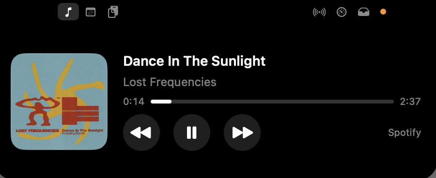
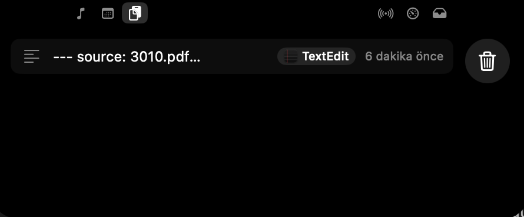
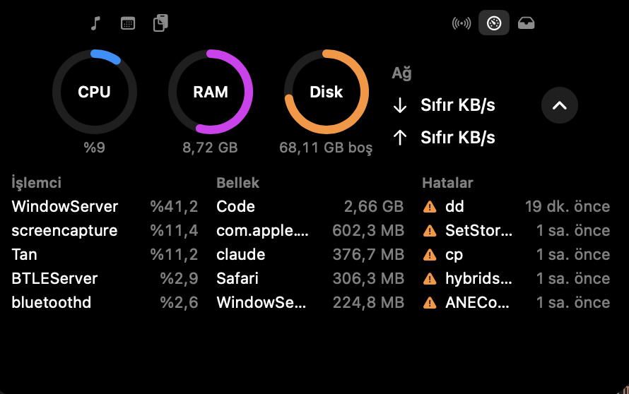
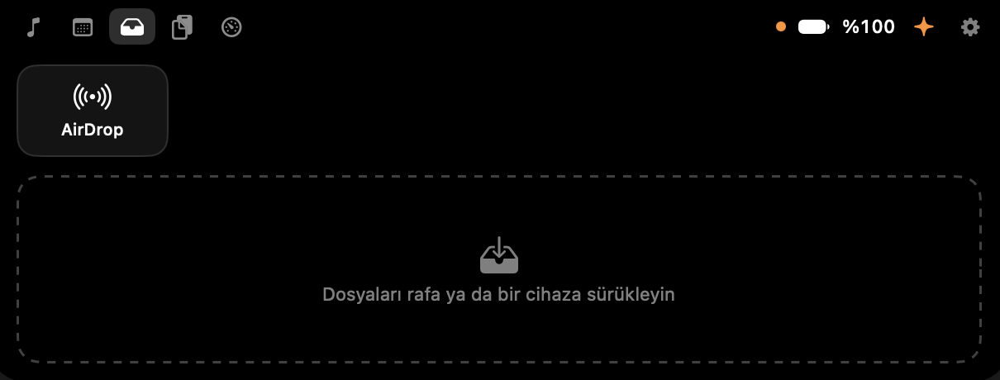
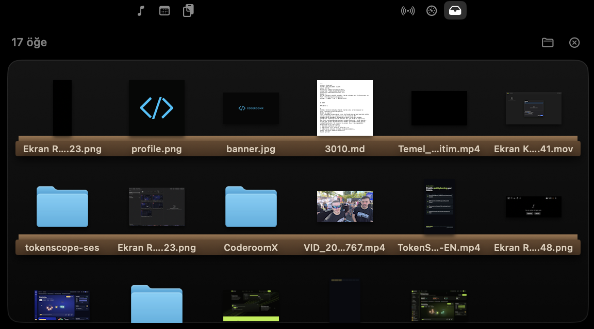
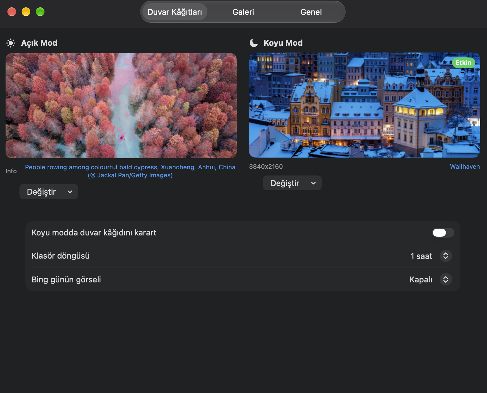
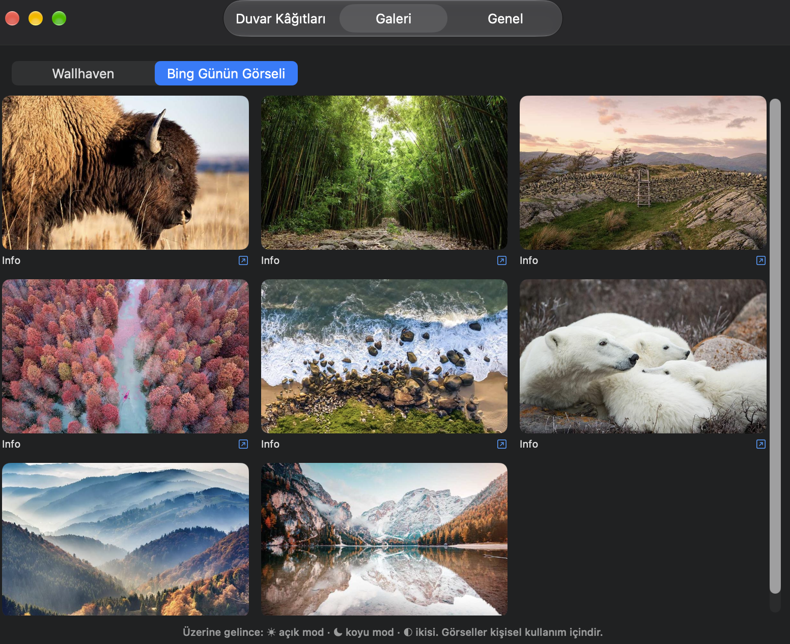
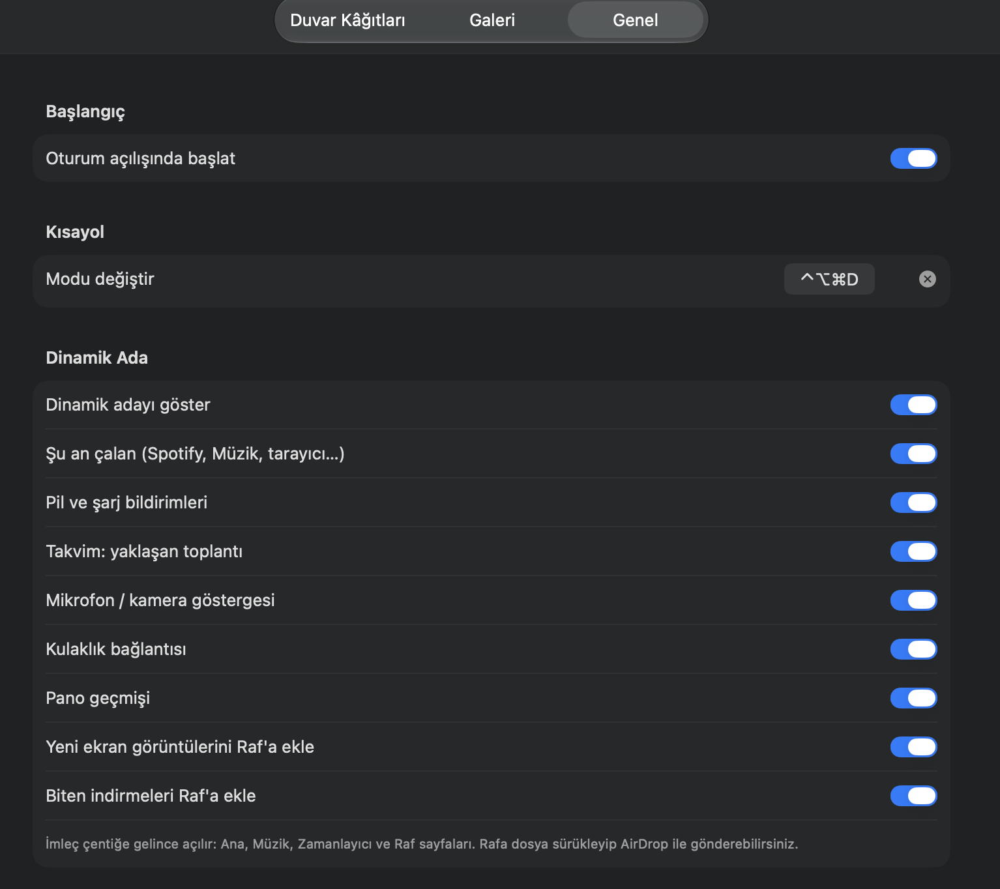

# Tan

[](https://github.com/oguzhancvk70/Tan/releases/latest)
[](https://github.com/oguzhancvk70/Tan/releases)


[](LICENSE)
[](https://github.com/oguzhancvk70/Tan/stargazers)

**A Dynamic Island for your Mac's notch — with a shelf that keeps your Desktop clean, clipboard history that remembers where you copied from, automatic light/dark mode wallpapers and live system stats.**

Tan is a lightweight, native macOS menu bar app written in Swift and SwiftUI. It turns the notch on your MacBook into an interactive "island" that shows what's playing, your next meeting and headphone status, collects everything that lands on your Desktop onto a browsable shelf, and shows detailed CPU / memory usage. It also switches your wallpaper when macOS changes between light and dark mode.

No third-party dependencies. No accounts. No telemetry. Everything runs locally on your Mac.

<p align="center">
  
</p>

> 🌍 Available in **English** and **Turkish** — follows your system language, or pick one in Settings → General. (Screenshots show the Turkish interface.)

---

## What's new in 1.4

- 🗄 **The Desktop shelf.** New files, folders, screenshots, screen recordings and downloads no longer pile up on your Desktop. Tan moves each one to `Documents/Ada` once it is fully written and puts it on a wooden shelf inside the island. → [How it works](#-desktop-shelf)
- 📂 **Browse folders inside the island.** Double-click a folder on the shelf and the island opens it in place. Go deeper into subfolders, then use the **Back** bar to return.
- ↔️ **Bigger shelf, compact everything else.** The island grows only on the Shelf page and returns to its compact size on every other page.
- 📋 **Clipboard shows the source.** Every clipboard entry shows the icon and name of the app you copied it from.
- 🎛 **Balanced tab bar.** Three pages on each side of the notch: Music · Calendar · Clipboard | AirDrop · System · Shelf. AirDrop devices now have their own page.
- 🧹 **Removed:** the Claude chat panel, and the battery and settings buttons on the island (macOS already shows battery in the menu bar; Settings are in the menu bar icon).

---

## Table of contents

- [Features](#features)
- [Requirements](#requirements)
- [Installation](#installation)
- [Building from source](#building-from-source)
- [Usage](#usage)
- [Permissions](#permissions)
- [Privacy](#privacy)
- [Known limitations](#known-limitations)
- [Project structure](#project-structure)
- [Contributing](#contributing)
- [License](#license)

---

## Features

### 🏝 Dynamic Island

Move the cursor onto the notch and the island expands. When collapsed, it shows live activity on both sides of the notch.

The expanded island has six pages, three on each side of the notch:

```
  ♪ Music   📅 Calendar   📋 Clipboard   ▐ notch ▌   📡 AirDrop   ⏱ System   🗄 Shelf
```


| Page | What it does |
| --- | --- |
| **Music** | Now playing from any app (Spotify, Apple Music, browsers…) with artwork, progress bar and play / pause / next / previous controls. Click the artwork to open the source app. |
| **Calendar** | Your next meeting with a countdown and a one-click **Join** button for video-call links. |
| **Clipboard** | The last 20 things you copied (text, images, files), each tagged with the **app it was copied from** (icon + name). Click an entry to copy it again; hover it to see the source app and, for files, their full path. Password-manager entries are ignored. |
| **AirDrop** | Every Apple device paired with your Mac (iPhone, iPad, Mac) appears as its own tile. Drop a file on a tile — or click it to send the files you parked on the shelf — and AirDrop opens with those files. |
| **Shelf** | Your Desktop, tidied up: everything new that lands on the Desktop sits here on wooden shelves, together with files you drag onto the notch. Double-click a folder to browse it inside the island. See [Desktop shelf](#-desktop-shelf) below. |
| **System** | CPU, RAM, disk and network gauges. Expand **Details** to see the top 5 processes by CPU and by memory, plus a **Problems** column listing crash, hang, resource and kernel-panic reports from the last 24 hours, and live thermal / memory-pressure warnings. The column stays empty when nothing is wrong. Click a report to open it in Console. |

#### Screenshots

<p align="center">
  
  <br><sub><b>Clipboard</b> — every entry shows the app it was copied from</sub>
</p>

<p align="center">
  
  <br><sub><b>System</b> — gauges, top processes by CPU and memory, and recent problems</sub>
</p>

<p align="center">
  
  <br><sub><b>AirDrop</b> — paired devices appear as tiles; drop a file on one to send it (screenshot from 1.3)</sub>
</p>

**Live activities & notifications** (each can be toggled in Settings):

- Song changes with artwork
- Charger connected / disconnected, low battery
- Upcoming meeting alerts
- Bluetooth headphones connected, with battery level
- Microphone 🟠 and camera 🟢 in-use indicators
- New screenshot / new download / item taken from the Desktop

### 🗄 Desktop shelf

Screenshots, screen recordings, downloads, exported files and folders usually end up on the Desktop and stay there. With the Desktop shelf turned on (Settings → General → **Collect new Desktop items on the Shelf**, on by default), Tan takes them off the Desktop and keeps them in the island instead.

<p align="center">
  
</p>

**What happens to a new Desktop item**

1. Tan notices the new file or folder on the Desktop.
2. It waits until the item is **completely finished** (see below).
3. It moves the item to `~/Documents/Ada`. This is a rename on the same disk, so the data itself is never copied or rewritten.
4. The island shows a short notification, and the item appears on the shelf.

**Your files are never moved half-written.** Instead of a fixed timer, an item is moved only when **all** of these are true:

| Check | Why |
| --- | --- |
| Size, modification date and (for folders) item count haven't changed for **10 seconds** | The item is no longer being written |
| No app has the file open (for folders: no file inside is open) | Ongoing screen recordings, exports and downloads keep the item on the Desktop for as long as they take |
| Finder is not copying it | Finder marks files while it copies them; Tan waits until the mark is gone |
| It is not a temporary or hidden file | `.download`, `.crdownload`, `.part`, `.tmp` and dot-files are always skipped |

Typical result: a screenshot or a small file moves after about 10–12 seconds. A long screen recording or a large download moves about 10 seconds after it finishes, however long it takes.

**What Tan never touches**

- Everything that was already on your Desktop when you turned the feature on, even if you rename it later.
- Items you put back with **Put back on Desktop**.
- A copy you drag from the shelf to the Desktop (Tan recognises it as yours).

**Using the shelf**

- Double-click a file to open it. Drag it out to any app, folder or the Desktop.
- Double-click a **folder** to open it inside the island. You can go into subfolders; a **Back** bar and a path (`Shelf › Projects › 2026`) show where you are. Collapsing the island returns to the shelf.
- Right-click an item for **Open**, **Show in Finder**, **Put back on Desktop** and **Move to Trash**.
- The folder button opens `Documents/Ada` in Finder.
- Images and videos show a thumbnail; when you hover an item, it lifts off the shelf.
- The island grows on the Shelf page so there is room to browse, and shrinks back on every other page.


### 🌗 Light & dark mode wallpapers

- Pick a separate wallpaper for light mode and for dark mode; Tan applies the right one whenever the appearance changes.
- Sources: macOS system wallpapers, your own files, a folder (rotates on a timer), **Wallhaven** (search and shuffle, no API key needed) and **Bing image of the day**.
- Optional automatic dimming of the wallpaper in dark mode.
- Rotation interval: 15 min, 1 h, 6 h or daily.
- Toggle the appearance from the menu bar, with a global hotkey, or with ⌥-click on the menu bar icon.

<table>
  <tr>
    <td align="center" width="50%"><br><sub><b>Wallpapers</b> — one for light, one for dark</sub></td>
    <td align="center" width="50%"><br><sub><b>Gallery</b> — Wallhaven and Bing image of the day</sub></td>
  </tr>
  <tr>
    <td align="center"><br><sub><b>General</b> — login, hotkey, island options</sub></td>
    <td></td>
  </tr>
</table>

---

## Requirements

- macOS **14 Sonoma** or later
- Apple Silicon or Intel Mac. A notched MacBook gives the best experience; on other displays the island appears as a small pill at the top center of the main screen.

---

## Installation

1. Download `Tan.dmg` from the [Releases](../../releases) page.
2. Open it and drag **Tan** into **Applications**.
3. Tan is **not notarized** by Apple (it's a free, open-source project without a paid developer account), so macOS will block it on first launch. Use either method:
   - **Right-click** `Tan.app` in Applications → **Open** → **Open**, or
   - run this once in Terminal:
     ```bash
     xattr -cr /Applications/Tan.app
     ```
4. Tan appears in the menu bar. It can start automatically at login (Settings → General).

---

## Building from source

You need **Xcode** and **XcodeGen**:

```bash
brew install xcodegen
git clone https://github.com/oguzhancvk70/Tan.git
cd Tan
make install
```

| Command | Description |
| --- | --- |
| `make build` | Generates the Xcode project and builds a Release app into `build.noindex/` |
| `make run` | Builds and launches the app from the build folder |
| `make install` | Builds, copies to `/Applications/Tan.app` and launches it |
| `make dmg` | Builds `build.noindex/Tan.dmg` |
| `make install-dmg` | Builds the DMG and installs from it |
| `make icon` | Regenerates the app icon |
| `make clean` | Removes build output |

**Code signing:** `project.yml` contains the maintainer's development team ID. To build with your own Apple ID, change `DEVELOPMENT_TEAM` in `project.yml` to your team, or switch to ad-hoc signing (`CODE_SIGN_IDENTITY: "-"`).

> The build folder is called `build.noindex` on purpose, so Spotlight doesn't index duplicate copies of the app.

---

## Usage

| Action | How |
| --- | --- |
| Open the island | Move the cursor onto the notch |
| Keep the Desktop clean | Nothing to do — new Desktop items move to the Shelf automatically |
| Park files on the shelf | Drag files onto the notch |
| Browse a folder on the shelf | Double-click it; use **Back** to return |
| Put an item back on the Desktop | Right-click it on the shelf → **Put back on Desktop** |
| See where you copied something from | Clipboard page — the app icon and name next to each entry |
| Send a file to a device | Drop it on a device tile on the AirDrop page |
| Toggle light / dark mode | **⌃⌥⌘D**, ⌥-click the menu bar icon, or the switch in the menu |
| Settings | Click the menu bar icon → Settings… (⌘,) |
| Change language | Settings → General → **Language** (System / Türkçe / English), then restart Tan |

Hotkeys can be changed in **Settings → General**.

---

## Permissions

Tan asks only for what a feature needs, when the feature first needs it:

| Permission | Used for |
| --- | --- |
| **Automation (System Events)** | Switching light / dark mode |
| **Automation (Spotify / Music)** | Music controls fallback |
| **Calendars** | Showing upcoming meetings |
| **Bluetooth** | Headphone battery level and listing paired devices for AirDrop |
| **Desktop folder** | Noticing new items on the Desktop for the shelf |
| **Documents folder** | Keeping shelf items in `Documents/Ada` |

Tan does **not** request Accessibility, Screen Recording or Full Disk Access. The app runs outside the App Sandbox so that it can read the now-playing info, the process list and diagnostic reports.

---

## Privacy

- **Nothing leaves your Mac**, except image downloads from Wallhaven / Bing that you choose to use.
- Clipboard history is kept **in memory only** and cleared when Tan quits. Items marked as concealed or transient by password managers are skipped.
- Desktop items are only **moved on your own disk** (Desktop → `Documents/Ada`). Nothing is uploaded, and you can turn the feature off at any time; items already on the shelf stay in `Documents/Ada`.
- The clipboard source is the app name macOS reports; it is kept in memory with the entry and never stored.
- The mic and camera indicators only check *whether* a device is in use; Tan never records audio or video.
- No analytics, no crash reporting, no network calls in the background besides the wallpaper sources.

---

## Known limitations

- **Now playing** uses Apple's private MediaRemote framework through a small helper that runs inside `/usr/bin/perl`. Apple has restricted this API in recent macOS versions, so a macOS update may break it until Tan is updated. A notification-based fallback for Spotify and Music keeps basic info working.
- **AirDrop to a specific device:** macOS has no public API to send directly to a chosen device. Dropping on a device tile opens the AirDrop sheet with your files, where you confirm the recipient.
- Wallpapers are applied per display; macOS offers no public API to set a different wallpaper per Space.
- The island is shown only on the main (notched) display.
- **Desktop shelf:** a file that an app keeps open (for example a video playing in QuickTime) stays on the Desktop until the app closes it. This is intentional, so nothing is moved while it is in use.
- **Clipboard source:** when an app doesn't label its clipboard data, Tan uses the app that was in front when the copy happened, which is right in almost every case.
- Showing system notifications or answering calls from the island is not possible with public APIs.

---

## Project structure

```
Sources/
├─ App/               App entry point, menu bar controller, central app controller, localization
├─ Core/              Appearance switching, wallpaper manager, dimming, hotkeys, login item
├─ Activities/        Now playing, battery, calendar, mic/camera, audio devices,
│                     clipboard, screenshots, downloads, Desktop collector, system stats, AirDrop
├─ Island/            Dynamic Island panel, views and pages
├─ Online/            Wallhaven and Bing sources
├─ WallpaperSources/  System / file / folder wallpaper sources
├─ Settings/          Preferences and storage
└─ UI/                Settings window and pickers
MediaRemoteAdapter/   Objective-C helper for now-playing info
Resources/Localization/  English and Turkish strings
Scripts/              App icon generator
project.yml           XcodeGen project definition
Makefile              Build, install and DMG targets
```

---

## Contributing

Issues and pull requests are welcome — especially:

- More languages — add `Resources/Localization/<lang>.lproj/Localizable.strings` (Turkish source strings are the keys; see `en.lproj` for the full list)
- Fixes after macOS updates
- New island pages and live activities

Please keep the app dependency-free and lightweight.

---

## License

Released under the [MIT License](LICENSE).

*Tan is an independent project and is not affiliated with Apple. "AirDrop", "Dynamic Island" and "macOS" are trademarks of Apple Inc.*
