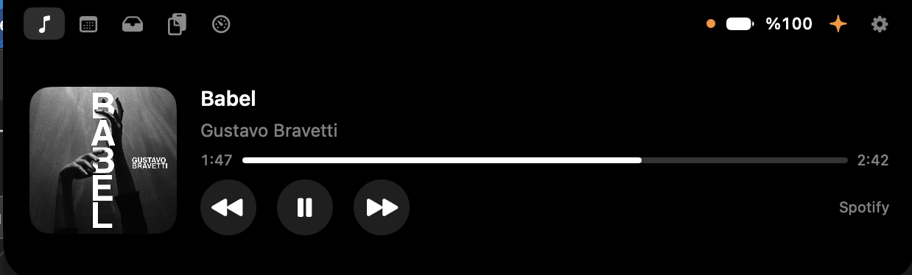
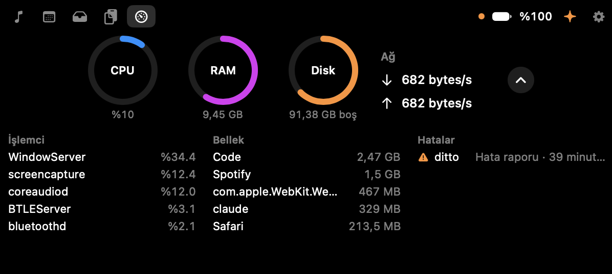
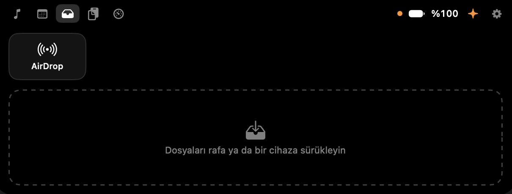
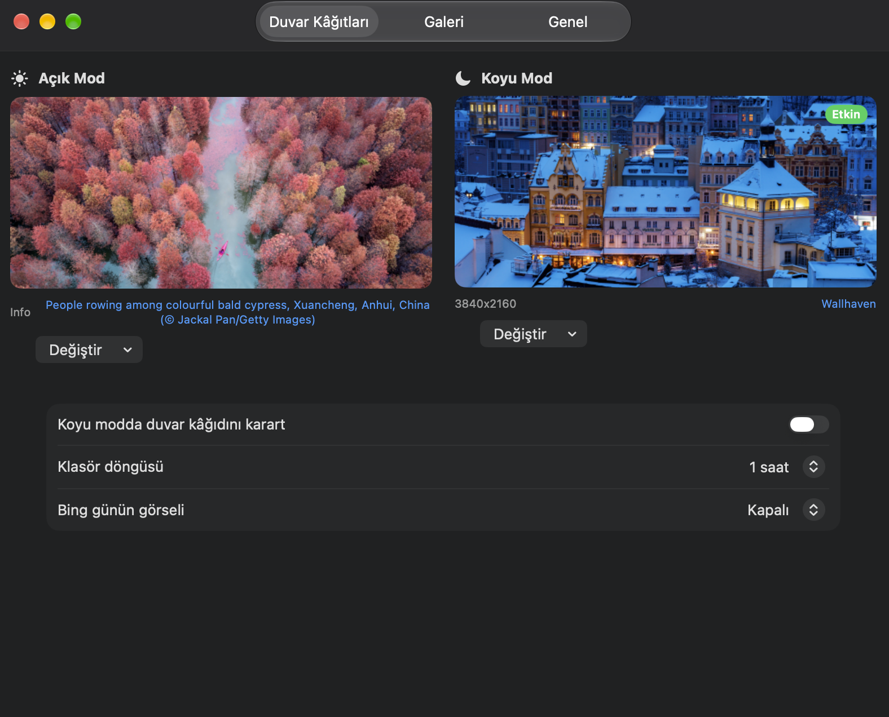
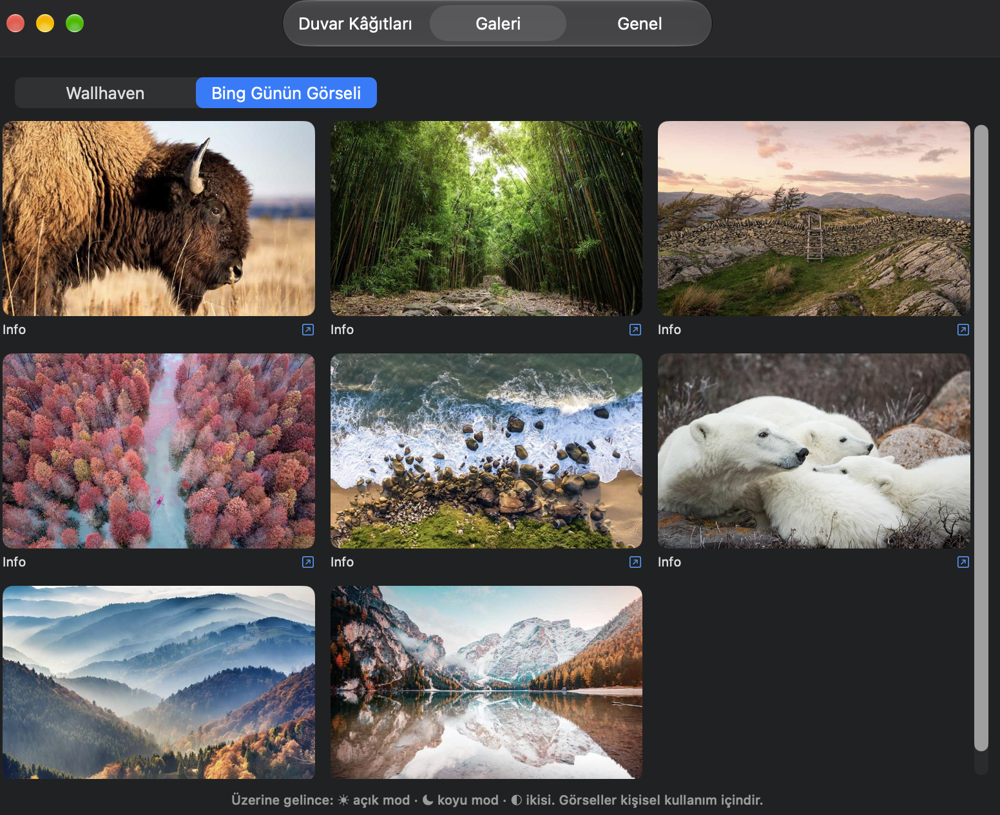
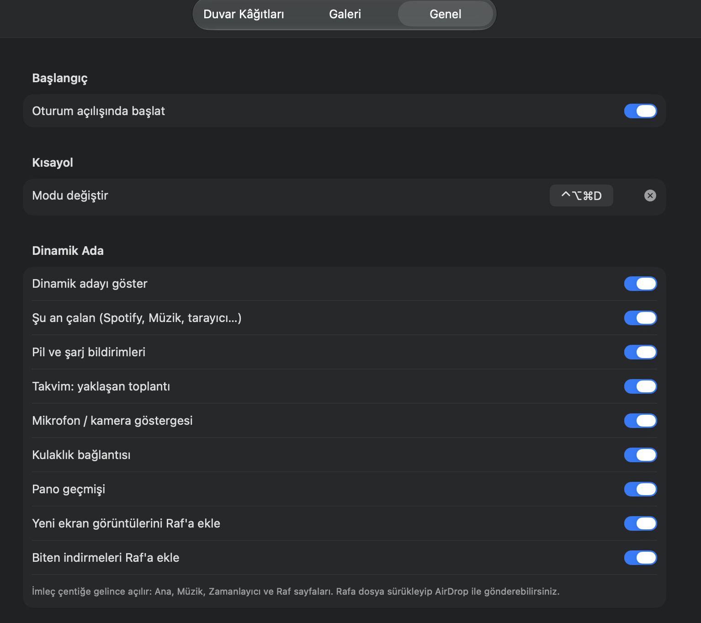
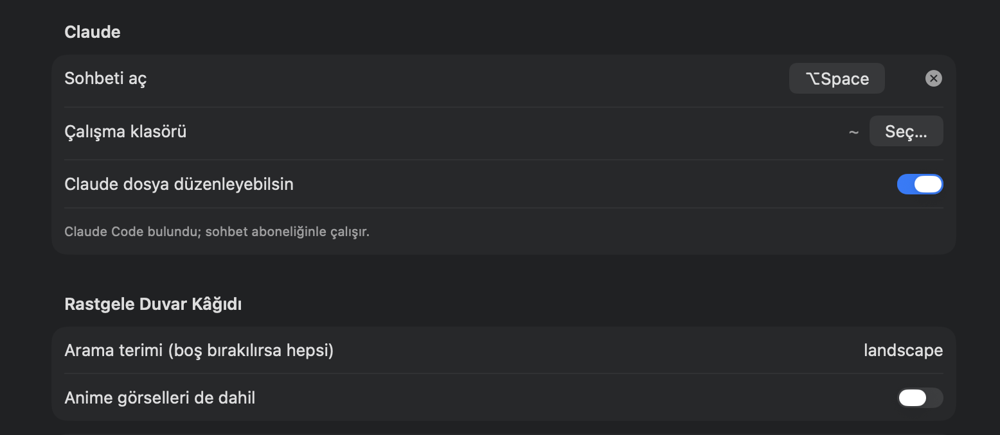
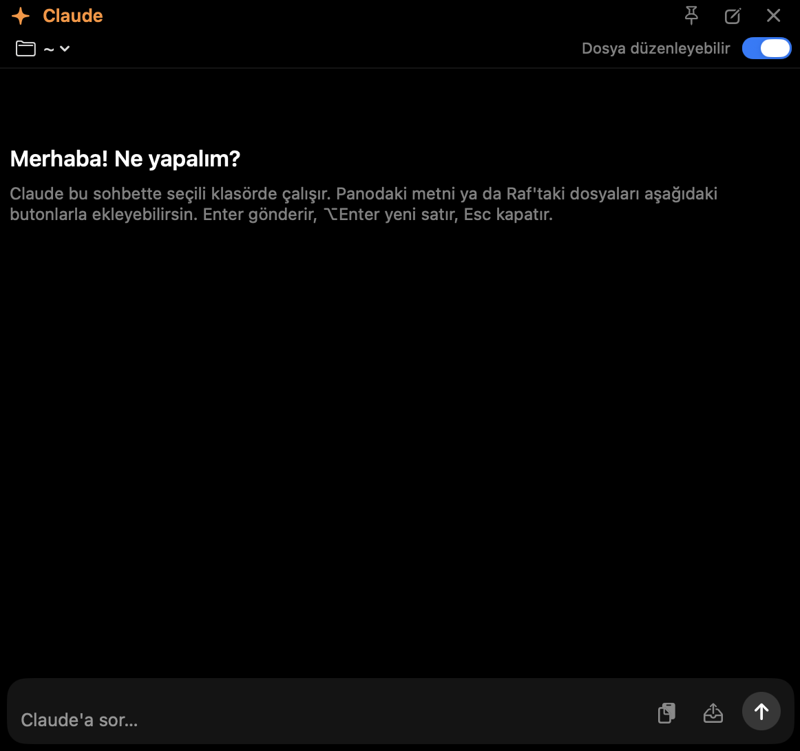

# Tan

**A Dynamic Island for your Mac's notch — plus automatic light/dark mode wallpapers, a Claude chat panel, clipboard history and live system stats.**

Tan is a lightweight, native macOS menu bar app written in Swift and SwiftUI. It turns the notch on your MacBook into an interactive "island" that shows what's playing, your next meeting, battery and headphone status, recent screenshots and downloads, and detailed CPU / memory usage. It also switches your wallpaper when macOS changes between light and dark mode.

No third-party dependencies. No accounts. No telemetry. Everything runs locally on your Mac.

<p align="center">
  
</p>

> 🌍 Available in **English** and **Turkish** — follows your system language, or pick one in Settings → General. (Screenshots show the Turkish interface.)

---

## Table of contents

- [Features](#features)
- [Requirements](#requirements)
- [Installation](#installation)
- [Building from source](#building-from-source)
- [Usage](#usage)
- [Permissions](#permissions)
- [Privacy](#privacy)
- [Known limitations](#known-limitations)
- [Project structure](#project-structure)
- [Contributing](#contributing)
- [License](#license)

---

## Features

### 🏝 Dynamic Island

Move the cursor onto the notch and the island expands. When collapsed, it shows live activity on both sides of the notch.


| Page | What it does |
| --- | --- |
| **Music** | Now playing from any app (Spotify, Apple Music, browsers…) with artwork, progress bar and play / pause / next / previous controls. Click the artwork to open the source app. |
| **Calendar** | Your next meeting with a countdown and a one-click **Join** button for video-call links. |
| **Shelf** | A temporary drop zone for files. Drag files onto the notch to park them, then drag them out anywhere. Recent screenshots and downloads land here automatically. |
| **AirDrop devices** | Every Apple device paired with your Mac (iPhone, iPad, Mac) appears as its own tile on the Shelf page. Drop a file on a tile — or click it to send everything on the shelf — and AirDrop opens with those files. |
| **Clipboard** | The last 20 things you copied (text, images, files). Click an entry to copy it again. Password-manager entries are ignored. |
| **System** | CPU, RAM, disk and network gauges. Expand **Details** to see the top 5 processes by CPU and by memory, plus a **Problems** column listing crash, hang, resource and kernel-panic reports from the last 24 hours, and live thermal / memory-pressure warnings. The column stays empty when nothing is wrong. Click a report to open it in Console. |

#### Screenshots

<p align="center">
  
  <br><sub><b>System</b> — gauges, top processes by CPU and memory, and recent problems</sub>
</p>

<p align="center">
  
  <br><sub><b>Shelf + AirDrop</b> — paired devices appear as tiles; drop a file on one to send it</sub>
</p>

**Live activities & notifications** (each can be toggled in Settings):

- Song changes with artwork
- Charger connected / disconnected, low battery
- Upcoming meeting alerts
- Bluetooth headphones connected, with battery level
- Microphone 🟠 and camera 🟢 in-use indicators
- New screenshot / new download


### 🌗 Light & dark mode wallpapers

- Pick a separate wallpaper for light mode and for dark mode; Tan applies the right one whenever the appearance changes.
- Sources: macOS system wallpapers, your own files, a folder (rotates on a timer), **Wallhaven** (search and shuffle, no API key needed) and **Bing image of the day**.
- Optional automatic dimming of the wallpaper in dark mode.
- Rotation interval: 15 min, 1 h, 6 h or daily.
- Toggle the appearance from the menu bar, with a global hotkey, or with ⌥-click on the menu bar icon.

<table>
  <tr>
    <td align="center" width="50%"><br><sub><b>Wallpapers</b> — one for light, one for dark</sub></td>
    <td align="center" width="50%"><br><sub><b>Gallery</b> — Wallhaven and Bing image of the day</sub></td>
  </tr>
  <tr>
    <td align="center"><br><sub><b>General</b> — login, hotkey, island options</sub></td>
    <td align="center"><br><sub><b>Claude &amp; random wallpaper</b> settings</sub></td>
  </tr>
</table>

### ✦ Claude chat panel

- A floating chat panel (⌥Space or the ✦ button on the island) powered by your local [Claude Code](https://claude.com/claude-code) CLI. It uses your existing Claude subscription — no API key is stored in Tan.
- Conversations continue (`--resume`), you can choose a working folder, and file edits can optionally be auto-accepted.
- Tan finds the `claude` binary automatically in Homebrew, `~/.local/bin`, `~/.claude/local` or the VS Code extension folder.

<p align="center">
  
</p>

---

## Requirements

- macOS **14 Sonoma** or later
- Apple Silicon or Intel Mac. A notched MacBook gives the best experience; on other displays the island appears as a small pill at the top center of the main screen.
- *Optional:* [Claude Code](https://claude.com/claude-code) installed and signed in, for the chat panel.

---

## Installation

1. Download `Tan.dmg` from the [Releases](../../releases) page.
2. Open it and drag **Tan** into **Applications**.
3. Tan is **not notarized** by Apple (it's a free, open-source project without a paid developer account), so macOS will block it on first launch. Use either method:
   - **Right-click** `Tan.app` in Applications → **Open** → **Open**, or
   - run this once in Terminal:
     ```bash
     xattr -cr /Applications/Tan.app
     ```
4. Tan appears in the menu bar. It can start automatically at login (Settings → General).

---

## Building from source

You need **Xcode** and **XcodeGen**:

```bash
brew install xcodegen
git clone https://github.com/oguzhancvk70/Tan.git
cd Tan
make install
```

| Command | Description |
| --- | --- |
| `make build` | Generates the Xcode project and builds a Release app into `build.noindex/` |
| `make run` | Builds and launches the app from the build folder |
| `make install` | Builds, copies to `/Applications/Tan.app` and launches it |
| `make dmg` | Builds `build.noindex/Tan.dmg` |
| `make install-dmg` | Builds the DMG and installs from it |
| `make icon` | Regenerates the app icon |
| `make clean` | Removes build output |

**Code signing:** `project.yml` contains the maintainer's development team ID. To build with your own Apple ID, change `DEVELOPMENT_TEAM` in `project.yml` to your team, or switch to ad-hoc signing (`CODE_SIGN_IDENTITY: "-"`).

> The build folder is called `build.noindex` on purpose, so Spotlight doesn't index duplicate copies of the app.

---

## Usage

| Action | How |
| --- | --- |
| Open the island | Move the cursor onto the notch |
| Park files on the shelf | Drag files onto the notch |
| Send a file to a device | Drop it on a device tile on the Shelf page |
| Toggle light / dark mode | **⌃⌥⌘D**, ⌥-click the menu bar icon, or the switch in the menu |
| Open the Claude chat | **⌥Space**, or the ✦ button on the island |
| Settings | Click the menu bar icon → Settings, or the ⚙︎ button on the island |
| Change language | Settings → General → **Language** (System / Türkçe / English), then restart Tan |

Hotkeys can be changed in **Settings → General**.

---

## Permissions

Tan asks only for what a feature needs, when the feature first needs it:

| Permission | Used for |
| --- | --- |
| **Automation (System Events)** | Switching light / dark mode |
| **Automation (Spotify / Music)** | Music controls fallback |
| **Calendars** | Showing upcoming meetings |
| **Bluetooth** | Headphone battery level and listing paired devices for AirDrop |

Tan does **not** request Accessibility, Screen Recording or Full Disk Access. The app runs outside the App Sandbox so that it can read the now-playing info, the process list and diagnostic reports.

---

## Privacy

- **Nothing leaves your Mac**, except image downloads from Wallhaven / Bing that you choose to use, and messages you send in the Claude panel (handled by your own Claude Code CLI).
- Clipboard history is kept **in memory only** and cleared when Tan quits. Items marked as concealed or transient by password managers are skipped.
- The mic and camera indicators only check *whether* a device is in use; Tan never records audio or video.
- No analytics, no crash reporting, no network calls in the background besides the wallpaper sources.

---

## Known limitations

- **Now playing** uses Apple's private MediaRemote framework through a small helper that runs inside `/usr/bin/perl`. Apple has restricted this API in recent macOS versions, so a macOS update may break it until Tan is updated. A notification-based fallback for Spotify and Music keeps basic info working.
- **AirDrop to a specific device:** macOS has no public API to send directly to a chosen device. Dropping on a device tile opens the AirDrop sheet with your files, where you confirm the recipient.
- Wallpapers are applied per display; macOS offers no public API to set a different wallpaper per Space.
- The island is shown only on the main (notched) display.
- Showing system notifications or answering calls from the island is not possible with public APIs.

---

## Project structure

```
Sources/
├─ App/               App entry point, menu bar controller, central app controller, localization
├─ Core/              Appearance switching, wallpaper manager, dimming, hotkeys, login item
├─ Activities/        Now playing, battery, calendar, mic/camera, audio devices,
│                     clipboard, screenshots, downloads, system stats, AirDrop
├─ Island/            Dynamic Island panel, views and pages
├─ Claude/            Claude Code CLI chat (stream-json) and its UI
├─ Online/            Wallhaven and Bing sources
├─ WallpaperSources/  System / file / folder wallpaper sources
├─ Settings/          Preferences and storage
└─ UI/                Settings window and pickers
MediaRemoteAdapter/   Objective-C helper for now-playing info
Resources/Localization/  English and Turkish strings
Scripts/              App icon generator
project.yml           XcodeGen project definition
Makefile              Build, install and DMG targets
```

---

## Contributing

Issues and pull requests are welcome — especially:

- More languages — add `Resources/Localization/<lang>.lproj/Localizable.strings` (Turkish source strings are the keys; see `en.lproj` for the full list)
- Fixes after macOS updates
- New island pages and live activities

Please keep the app dependency-free and lightweight.

---

## License

Released under the [MIT License](LICENSE).

*Tan is an independent project and is not affiliated with Apple or Anthropic. "AirDrop", "Dynamic Island" and "macOS" are trademarks of Apple Inc.; "Claude" is a trademark of Anthropic.*
